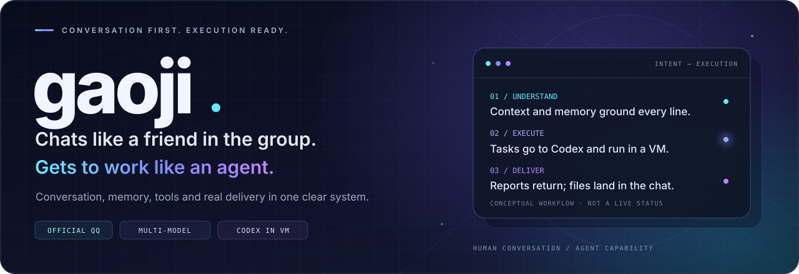
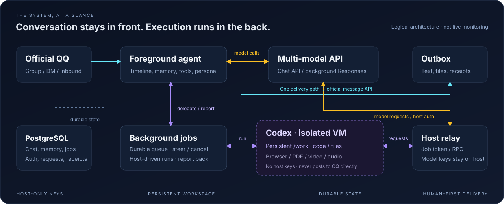

<p align="center">
  
</p>

<p align="center">
  <strong>English</strong> &nbsp;·&nbsp; <a href="README.zh-CN.md">简体中文</a>
</p>

<p align="center">
  <a href="https://github.com/zty20040403/gaojibot/actions/workflows/ci.yml"></a>
  
  
  
  <a href="LICENSE"></a>
</p>

<h3 align="center">Remembers things, gets work done, and knows when to stay quiet.</h3>

<p align="center">
  A multi-model AI group member for the official QQ bot platform.<br />
  The foreground agent chats; research, code, file and video tasks go to Codex in an isolated VM.<br />
  From one sentence to a result you can actually use.
</p>

<p align="center">
  <a href="#capabilities">Capabilities</a> &nbsp; / &nbsp;
  <a href="#architecture">Architecture</a> &nbsp; / &nbsp;
  <a href="#quick-start">Quick start</a> &nbsp; / &nbsp;
  <a href="#deployment">Deployment</a> &nbsp; / &nbsp;
  <a href="#documentation">Documentation</a>
</p>

---

<a id="capabilities"></a>
## 01 · More than chat: it finishes the job

| **CONVERSATION** | **MEMORY** | **EXECUTION** |
| :--- | :--- | :--- |
| Group and private chats, switchable models, replies sent paragraph by paragraph.<br />When it has nothing to add it outputs `[silence]` and sends nothing. | A stable timeline, a `history` tool that reads the original messages, and a separate memory per conversation.<br />Notes are tidied every night, so the prompt does not carry the whole history. | Codex runs research, code, file and video tasks in a VM that belongs to the group.<br />You can ask for status, add requirements, answer its questions, or cancel. |
| **MULTIMODAL** | **AUTOMATION** | **CONTROL** |
| Vision models receive up to four current/quoted images; `view_image` finds recent images, with descriptions for text-only models. Optional scoped captions are searchable in history.<br />Animated stickers and voice replies in Chinese.<br />Attachment import, a browser, PDFs, video transcription and file delivery. | One-off reminders and recurring tasks, all in Asia/Shanghai time.<br />Recurring tasks run in the background, and the foreground agent delivers the result. | An admin console shows chats, usage, jobs and recent model requests.<br />Jobs started from the owner's private chat can inspect the server through a read-only host tool. |

> **Chat stays chat, and tasks stay tasks.** The foreground agent is never blocked by a long job. The background agent never posts to the group itself: it hands back a report, and the foreground agent delivers it in the same persona.

### What happens when you ask

| What you ask for | How gaoji handles it |
| :--- | :--- |
| "Look up recent RAM prices and give me a chart and a CSV." | The foreground agent says it has started → the background agent searches and processes the data → you get conclusions with sources, plus the files. |
| "What is this video about?" | The attachment is imported → frames are extracted and viewed and the audio is transcribed in the VM → the foreground agent gives a summary. |
| "Add the other model to that as well." | It finds the running job and steers it, so the same work is not started twice. |
| "Remind me about the meeting at 3 pm tomorrow." | It creates a one-off reminder, delivered on time through the official message channel. |

<sub>These are examples of capabilities and flows, not platform screenshots or a promise of fixed output. Real results depend on the model, the host configuration and the permissions QQ grants.</sub>

<a id="architecture"></a>
## 02 · The foreground chats, the background works, and the boundary is clear

<p align="center">
  
</p>

- **Conversation layer**: official inbound events, binding and permissions → timeline and memory → multi-model agent → one delivery path.
- **Execution layer**: durable jobs → the host drives Codex → `/work` in the conversation's VM → the report wakes the foreground agent.
- **State layer**: PostgreSQL stores chats, memory, jobs, grants, model requests and delivery receipts.

<details>
<summary><strong>Runtime limits and security design</strong></summary>

- At most **3** background jobs run at once, each for up to **2 hours**. Jobs can be steered, interrupted and cancelled.
- A conversation reuses its own VM and `/work`. A job that was running when the service restarted is marked as interrupted; its files are kept, and it is not silently resumed.
- **QQ credentials, model keys and operations credentials stay on the host.** The VM only receives a revocable job token.
- The VM's network cannot reach the host or the internal network. Only the public internet, DNS and the relay ports are allowed. Using a VM is not, by itself, treated as isolation.
- The background agent cannot send QQ messages. `history`, search and `ask_main` are called by the host on its behalf; `ops_read` is available only to jobs started from the owner's private chat.
- A finished job, an uploaded file, a queued message and a platform receipt are separate stages. **A generated result is not counted as delivered.**

See [Sandbox security](docs/sandbox-security.md) and the [current handoff record](docs/HANDOFF.md).

</details>

<a id="quick-start"></a>
## 03 · Run it locally

**You need**: Python 3.12+, [uv](https://docs.astral.sh/uv/), PostgreSQL 17 with pgvector, official QQ bot credentials and a model API. For the full file, browser and video features, use a Linux host with KVM configured.

**① Get the project and install the locked dependencies**

```sh
git clone https://github.com/zty20040403/gaojibot.git
cd gaojibot
uv sync --locked
cp .env.example .env
```

**② Configure the host**

Edit `.env`. At minimum, set the database, the model, and the paths of the protected credential files for the official QQ bot. File features also need the host configuration and a VM backend; a single switch does not enable them.

| Where | What it covers |
| :--- | :--- |
| [`.env.example`](.env.example) | Database, models, persona, search, VM and background job settings. |
| [Official QQ integration](docs/qq-official.md) | Connecting the bot, binding, and how official sending behaves. |
| [Host configuration](docs/qq-official-host-config.md) | Files, media, proactive replies and optional features. |

**③ Migrate the database and start**

```sh
uv run python -m src.bot_storage.cli upgrade
uv run python bot.py
```

> [!IMPORTANT]
> The AppID, AppSecret and binding pepper are read from private files on the host with mode `0600`. Do not commit secrets, real QQ numbers, openids or group numbers, and do not copy credentials into the VM. Admin identity comes from a verified official private-chat event; a plain QQ number is not an openid.

<a id="deployment"></a>
## 04 · Deploy with NixOS

The flake provides the default package, `sandbox-image`, `nixosModules.default`, and separate cluster-control and worker modules.

```nix
services.gaoji = {
  enable = true;
  environmentFile = "/run/secrets/gaoji.env";
  qqOfficial = {
    enable = true;
    appIdFile = "/run/secrets/qq-app-id";
    appSecretFile = "/run/secrets/qq-app-secret";
    bindPepperFile = "/run/secrets/qq-bind-pepper";
    hostConfigFile = "/run/secrets/qq-host.json";
  };
};
```

Persistent workspaces also need `sandbox.enable = true`, `sandbox.backend = "vm"`, a pinned Debian cloud image and `sandbox.vmRoot`. The minimal example above does not include the full VM configuration.

The background model and its reasoning effort can be changed on the console's jobs and delivery page. `opsRead.baseUrl` and `opsRead.tokenFile` are read only by the host. `voiceAsr.enable` turns on a local transcription fallback for short voice messages. Existing VMs must be upgraded explicitly; group files are kept.

**Read before going live → [Deployment and data changes](docs/deploy-rework.md) · [Sandbox security](docs/sandbox-security.md)**

<a id="documentation"></a>
## 05 · Documentation

Most documents are currently written in Chinese.

| I want to know… | Start here |
| :--- | :--- |
| How QQ is connected, bound and sent to | [Official QQ integration](docs/qq-official.md) |
| How files, media and proactive replies are enabled | [Official QQ host configuration](docs/qq-official-host-config.md) |
| Why the VM cannot reach the host or the internal network | [Sandbox security](docs/sandbox-security.md) |
| How to deploy, back up and adjust historical data | [Deployment guide](docs/deploy-rework.md) |
| What is implemented and what still awaits acceptance | [Latest handoff record](docs/HANDOFF.md) |

<details>
<summary><strong>Development checks and contribution rules</strong></summary>

```sh
# First set GAOJI_TEST_PASSWORD for the local PostgreSQL test container.
source tools/dev/testenv.sh gaoji_test
python -m unittest discover -s tests -p 'test_*.py'
ruff check bot.py src tests tools migrations nix
python tools/dev/check_unresolved_imports.py src
cd admin-ui && npm ci && npm run build
```

Tests use a separate local database and never the production QQ credentials. Read [AGENTS.md](AGENTS.md) before contributing: each PR does one thing, features are accepted on real behaviour, and a simulated receipt does not count as a real delivery.

</details>

<details>
<summary><strong>Current scope and older versions</strong></summary>

gaoji currently targets the official QQ platform only. The old OneBot/NapCat adapter, the desktop app, project workspaces, the group wiki, pinned messages, MCP, bridges and multi-role sub-agents have been removed. Their code is kept under the `pre-rework-20261031` tag and is not planned work on the current roadmap.

The GitHub bot account and automatic pull requests are on hold. Whether long-job results and reminders can be sent proactively also depends on the target group's permissions and the official quota.

</details>

---

<p align="center">
  <strong>Keep the conversation human. Let the agent do the work.</strong><br />
  <sub>Built by Kenneth · <a href="LICENSE">MIT License</a> · <a href="https://github.com/zty20040403/gaojibot/issues">Feedback and suggestions</a></sub>
</p>
