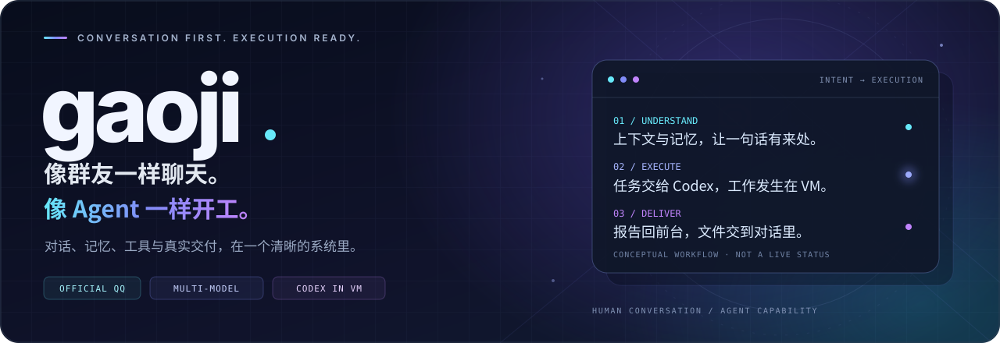
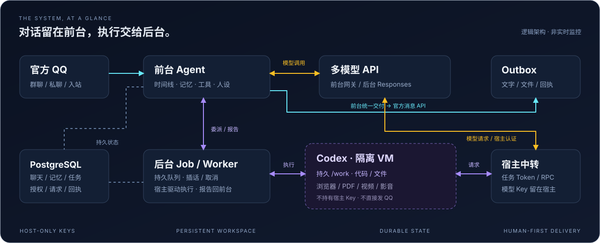

<p align="center">
  
</p>

<p align="center">
  <a href="https://github.com/zty20040403/gaojibot/actions/workflows/ci.yml"></a>
  
  
  
  <a href="LICENSE"></a>
</p>

<h3 align="center">会记事、会开工，也知道什么时候该安静。</h3>

<p align="center">
  一个面向官方 QQ 的多模型 AI 群友。<br />
  前台认真聊天，后台把研究、代码、文件和视频任务交给隔离 VM 里的 Codex。<br />
  从一句话，到一份真正能交付的结果。
</p>

<p align="center">
  <a href="#capabilities">核心能力</a> &nbsp; / &nbsp;
  <a href="#architecture">系统架构</a> &nbsp; / &nbsp;
  <a href="#quick-start">快速开始</a> &nbsp; / &nbsp;
  <a href="#deployment">部署</a> &nbsp; / &nbsp;
  <a href="#documentation">文档</a>
</p>

---

<a id="capabilities"></a>
## 01 · 不止于聊天，也能把事情做完

| **CONVERSATION · 自然对话** | **MEMORY · 持久记忆** | **EXECUTION · 后台执行** |
| :--- | :--- | :--- |
| 群聊与私聊、多模型切换、按自然段回复。<br />该安静时输出 `[silence]`，不强行刷存在感。 | 稳定时间线、`history` 原文查询、每会话独立记忆。<br />每天整理笔记，不把全部历史硬塞进提示词。 | 群独立 VM 内的 Codex 处理研究、代码、文件和视频。<br />支持状态查询、追加要求、反问和取消。 |
| **MULTIMODAL · 不只读文字** | **AUTOMATION · 到点就做** | **CONTROL · 看得见过程** |
| 图片理解、动态表情包、中文语音回复。<br />附件导入、浏览器、PDF、视频转写与文件交付。 | 一次性提醒和周期任务，统一使用 Asia/Shanghai。<br />周期任务交后台执行，结果再由前台送回。 | 管理台查看聊天、用量、任务和最近模型请求。<br />管理员私聊任务可通过宿主只读检查服务器。 |

> **聊天像聊天，任务像任务。** 前台不堵在长流程里；后台不直接向群里发消息，而是交回报告，让前台用一致的人设整理和交付。

### 你说一句，它可以这样开工

| 你想做的事 | Gaoji 的工作方式 |
| :--- | :--- |
| 「查一下最近的内存价格，整理成图和 CSV」 | 前台报告开始 → 后台检索和处理数据 → 交回带来源的结论与文件。 |
| 「这段视频讲了什么？」 | 导入附件 → VM 内抽帧、看画面、转写音轨 → 前台给出总结。 |
| 「顺便把另一款型号也加上」 | 找到当前任务并插话，不为同一件事重复开工。 |
| 「明天下午三点提醒我开会」 | 创建一次性提醒，到点经官方消息通道投递。 |

<sub>以上是能力与流程示例，不是平台截图或固定输出承诺。实际效果取决于模型、宿主配置与 QQ 平台权限。</sub>

<a id="architecture"></a>
## 02 · 前台会聊，后台会做，边界清楚

<p align="center">
  
</p>

- **对话层**：官方入站、绑定与权限 → 时间线和记忆 → 多模型 Agent → 统一投递。
- **执行层**：持久 Job → 宿主驱动 Codex → 会话 VM 的 `/work` → 报告唤醒前台。
- **状态层**：PostgreSQL 保存聊天、记忆、任务、授权、模型请求与发送回执。

<details>
<summary><strong>展开运行边界与安全设计</strong></summary>

- 同时最多 **3 个**活跃后台任务，每个最长 **2 小时**；支持插话、中断和取消。
- 同一会话复用自己的 VM 和 `/work`。运行任务在服务重启后标记中断，文件保留，不假装自动续跑。
- **QQ 凭据、模型 Key 和运维凭据只留在宿主**。VM 只拿可撤销的任务 Token。
- VM 网络限制宿主及内网访问，仅放行公网、DNS 和指定中转通道；不能把“用了 VM”当作隔离已经完成。
- 后台不能直接发送 QQ。`history`、搜索和 `ask_main` 由宿主代调用；`ops_read` 仅供 owner 私聊发起的任务。
- 任务完成、文件上传、消息入队和平台回执是不同阶段。**不把生成成功当作最终送达。**

详见 [沙箱安全边界](docs/sandbox-security.md) 与 [当前交接记录](docs/HANDOFF.md)。

</details>

<a id="quick-start"></a>
## 03 · 从本地启动开始

**准备好**：Python 3.12+、[uv](https://docs.astral.sh/uv/)、启用 pgvector 的 PostgreSQL 17、官方 QQ 机器人凭据和模型 API。完整文件/浏览器/视频能力推荐使用配置好的 Linux KVM 宿主。

**① 获取项目与锁定依赖**

```sh
git clone https://github.com/zty20040403/gaojibot.git
cd gaojibot
uv sync --locked
cp .env.example .env
```

**② 配置宿主环境**

编辑 `.env`，至少配置数据库、模型，以及官方 QQ 的受保护凭据文件路径。文件能力还需要宿主配置和 VM 后端，不能只打开一个开关。

| 配置入口 | 负责什么 |
| :--- | :--- |
| [`.env.example`](.env.example) | 数据库、模型、人设、搜索、VM 和后台任务参数。 |
| [官方 QQ 接入](docs/qq-official.md) | 机器人接入、绑定和官方发送行为。 |
| [宿主配置](docs/qq-official-host-config.md) | 文件、媒体、主动接话及可选能力。 |

**③ 迁移数据库并启动**

```sh
uv run python -m src.bot_storage.cli upgrade
uv run python bot.py
```

> [!IMPORTANT]
> AppID、AppSecret 和绑定 pepper 从宿主私有文件读取，权限使用 `0600`。不要提交密钥、真实 QQ/openid 或群号，不要把凭据复制进 VM。管理员身份来自核对过的官方私聊事件，普通 QQ 号不是 openid。

<a id="deployment"></a>
## 04 · 用 NixOS 管理运行环境

Flake 提供默认包、`sandbox-image`、`nixosModules.default`，以及独立的 cluster-control / worker 模块。

```nix
services.gaoji = {
  enable = true;
  environmentFile = "/run/secrets/gaoji.env";
  qqOfficial = {
    enable = true;
    appIdFile = "/run/secrets/qq-app-id";
    appSecretFile = "/run/secrets/qq-app-secret";
    bindPepperFile = "/run/secrets/qq-bind-pepper";
    hostConfigFile = "/run/secrets/qq-host.json";
  };
};
```

持久工作区还需 `sandbox.enable = true`、`sandbox.backend = "vm"`、固定版本 Debian cloud image 和 `sandbox.vmRoot`。上述最小示例不包含完整 VM 配置。

后台模型及推理强度可在管理台「任务与投递」修改。`opsRead.baseUrl/tokenFile` 仅供宿主读取；`voiceAsr.enable` 可启用短语音本地转写回退。已有 VM 需要显式升级，群文件继续保留。

**上线前先读 → [部署与数据调整](docs/deploy-rework.md) · [沙箱安全](docs/sandbox-security.md)**

<a id="documentation"></a>
## 05 · 文档导航

| 我想了解… | 从这里开始 |
| :--- | :--- |
| QQ 如何接入、绑定与发送 | [官方 QQ 接入](docs/qq-official.md) |
| 文件、媒体和主动接话如何启用 | [官方 QQ 宿主配置](docs/qq-official-host-config.md) |
| VM 为什么不能访问宿主和内网 | [Sandbox Security](docs/sandbox-security.md) |
| 如何部署、备份和调整历史数据 | [部署说明](docs/deploy-rework.md) |
| 哪些已实现、哪些仍待验收 | [HANDOFF 最新执行记录](docs/HANDOFF.md) |

<details>
<summary><strong>开发检查与贡献约定</strong></summary>

```sh
# 先配置本地 PostgreSQL 测试容器所需的 GAOJI_TEST_PASSWORD。
source tools/dev/testenv.sh gaoji_test
python -m unittest discover -s tests -p 'test_*.py'
ruff check bot.py src tests tools migrations nix
python tools/dev/check_unresolved_imports.py src
cd admin-ui && npm ci && npm run build
```

测试使用独立本地库，不使用正式 QQ 凭据。贡献前请读 [AGENTS.md](AGENTS.md)：每个 PR 聚焦一件事，功能验收看真实行为，不把模拟回执当作真实送达。

</details>

<details>
<summary><strong>当前范围与旧版本</strong></summary>

当前仅面向官方 QQ。旧 OneBot/NapCat、桌面 App、项目工作区、群百科、固定消息、MCP、桥接和多角色 Sub-Agent 已移除，旧实现保存在 `pre-rework-20261031` 标签；不是当前路线的待完成功能。

GitHub 机器人账号与自动提 PR 功能暂缓。长任务结果和提醒能否主动发出，还取决于目标群权限和官方配额。

</details>

---

<p align="center">
  <strong>Keep the conversation human. Let the agent do the work.</strong><br />
  <sub>Built by Kenneth · <a href="LICENSE">MIT License</a> · <a href="https://github.com/zty20040403/gaojibot/issues">反馈与建议</a></sub>
</p>
