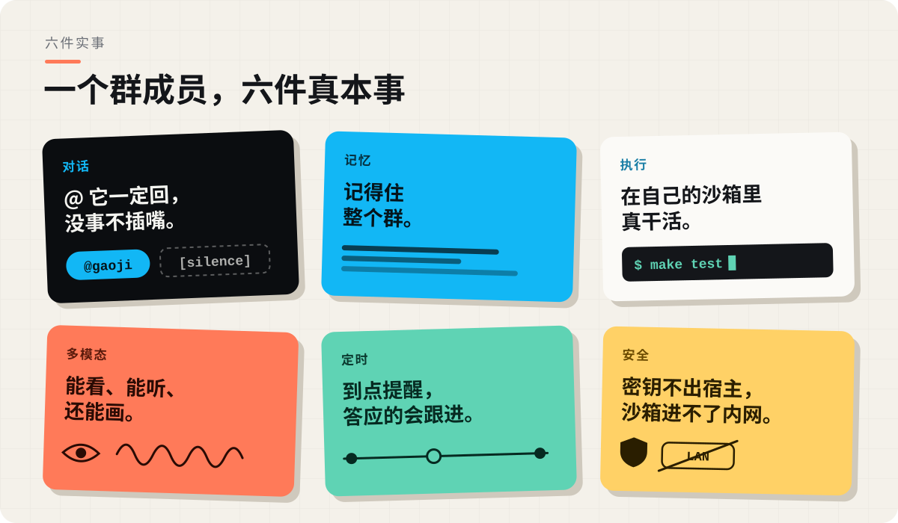
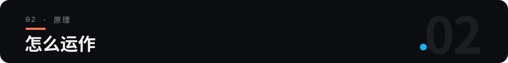
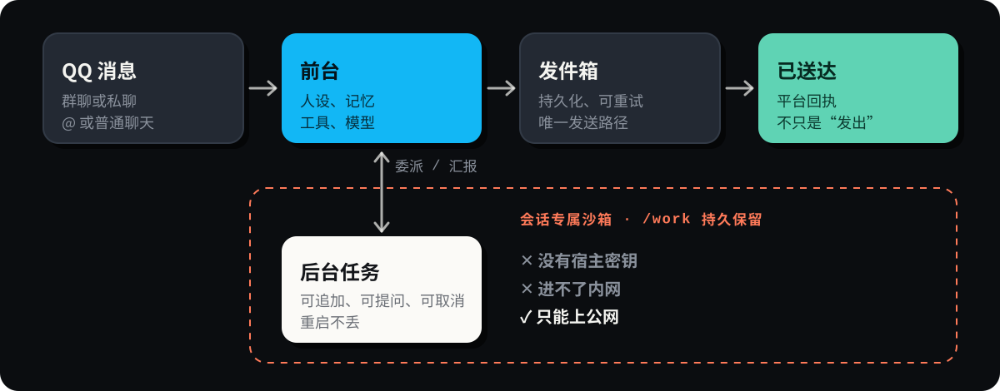
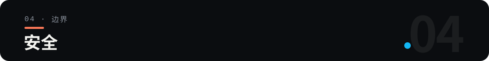

<p align="right">
  <a href="./README.md">English</a> · <strong>简体中文</strong>
</p>

<p align="center">
  
</p>

<p align="center">
  <a href="https://github.com/zty20040403/gaojibot/actions/workflows/ci.yml"></a>
  
  
  
  <a href="LICENSE"></a>
  <a href="https://github.com/zty20040403/gaojibot/stargazers"></a>
</p>

<p align="center">
  <a href="#what-it-does">能做什么</a> · <a href="#how-it-works">怎么运作</a> · <a href="#get-started">快速开始</a> · <a href="#security">安全</a> · <a href="#documentation">文档</a>
</p>

<a id="what-it-does"></a>
<p align="center">
  
</p>

<p align="center">
  
</p>

**gaoji** 是住在你 QQ 群里的 AI 群成员。@ 它、私聊它一定回，不是跟它说的话不插嘴；记得群里的事；查资料、写代码、处理文件和视频这类长活，交给这个会话专属沙箱里的编程 agent。它干活的时候你照常聊天，做完用同一个口吻把结果发回来。

| 你说 | gaoji 做 |
| :--- | :--- |
| *「对比一下这个月的内存价格，给我图表和 CSV。」* | 先说开始了 → 后台任务搜索并处理数据 → 发回带来源的结论和文件。 |
| *「这个视频讲了什么？」* | 导入附件 → 在沙箱里抽帧、转写音频 → 回一段总结。 |
| *「刚才那个再加上另一个模型。」* | 找到正在跑的任务追加要求，不会重复开一个。 |
| *「明天下午三点提醒我开会。」* | 建一个一次性提醒，到点准时发。 |

<sub>以上是真实流程的示例，不是截图。实际效果取决于模型、宿主配置和 QQ 给的权限。</sub>

**和普通机器人有什么不一样**

|  | 常见的聊天机器人 | gaoji |
| :--- | :--- | :--- |
| **什么时候说话** | 什么都回，或者只认命令 | @ 它、私聊它一定回；其他时候有用才开口 |
| **记忆** | 只记得最近几条 | 每个会话独立记忆，能翻全部原始记录，给常来的人各记一张印象卡 |
| **长任务** | 卡住聊天，或者直接超时 | 持久化任务，边聊边查进度、追加要求或取消 |
| **代码在哪跑** | 在机器人宿主上，或者根本不能跑 | 在会话自己的 NixOS 容器里，`/work` 持久保留 |
| **发送** | 发出去就不管了 | 持久化发件箱加平台真实回执 |

<a id="how-it-works"></a>
<p align="center">
  
</p>

<p align="center">
  
</p>

- **前台**：QQ 官方消息 → 时间线和记忆 → 多模型 agent → 唯一一条持久化发送路径。
- **后台**：持久化任务驱动会话容器里的编程 agent，`/work` 持久保留，做完的汇报唤醒前台发出去。
- **状态**：PostgreSQL 保存消息账本、记忆、任务、定时任务和发送回执。

<a id="get-started"></a>
<p align="center">
  
</p>

需要 Python 3.12+、[uv](https://docs.astral.sh/uv/)、带 pgvector 的 PostgreSQL 17、QQ 官方机器人凭据和一个模型 API。文件、浏览器和视频功能需要一台开了 KVM 的 Linux 主机。

```sh
git clone https://github.com/zty20040403/gaojibot.git
cd gaojibot
uv sync --locked
cp .env.example .env          # 数据库、模型、QQ 凭据文件路径
uv run python -m src.bot_storage.cli upgrade
uv run python bot.py
```

| 配置什么 | 看哪里 |
| :--- | :--- |
| 数据库、模型、人设、搜索、沙箱、后台任务 | [`.env.example`](.env.example) |
| 接入和绑定 QQ 官方机器人 | [QQ 官方接入](docs/qq-official.md) |
| 文件、媒体和主动接话 | [宿主配置](docs/qq-official-host-config.md) |

<details>
<summary><strong>NixOS 部署</strong></summary>

flake 提供软件包和 `nixosModules.default`。

```nix
services.gaoji = {
  enable = true;
  environmentFile = "/run/secrets/gaoji.env";
  qqOfficial = {
    enable = true;
    appIdFile = "/run/secrets/qq-app-id";
    appSecretFile = "/run/secrets/qq-app-secret";
    bindPepperFile = "/run/secrets/qq-bind-pepper";
    hostConfigFile = "/run/secrets/qq-host.json";
  };
};
```

会话工作区以 NixOS 容器（`systemd-nspawn`）运行，需要 `sandbox.enable = true`、`sandbox.vmRoot`、`systemd.network.enable = true` 和 `networking.nftables.enable = true`。容器根文件系统每次重启重建，`/work` 保留。上线前请先读[容器沙箱](docs/container-sandbox.md)。

</details>

<a id="security"></a>
<p align="center">
  
</p>

- **密钥留在宿主。** QQ 凭据、模型密钥和运维凭据都不进沙箱，沙箱只拿到可撤销、限定会话的令牌。
- **沙箱碰不到你的网络。** 只放行公网、DNS 和中转端口，宿主和内网都访问不了。
- **人说了算。** 群主和管理员可以在自己的群里 `/stop`、`/start`、`/kill`；管理台能看会话、用量、任务和审计记录。
- **生成了不算送达。** 任务完成、文件上传、消息排队、平台回执，分开记录。

> [!IMPORTANT]
> AppID、AppSecret 和绑定 pepper 从宿主上权限为 `0600` 的文件读取。不要提交密钥、真实 QQ 号、openid 或群号，也不要把凭据复制进沙箱。详见[沙箱安全](docs/sandbox-security.md)。

<a id="documentation"></a>
## 文档

| 我想知道…… | 从这里看 |
| :--- | :--- |
| QQ 怎么接入、绑定和发送 | [QQ 官方接入](docs/qq-official.md) |
| 文件、媒体和主动接话怎么开 | [宿主配置](docs/qq-official-host-config.md) |
| 为什么沙箱访问不了宿主和内网 | [沙箱安全](docs/sandbox-security.md) |
| 会话工作区怎么运行 | [容器沙箱](docs/container-sandbox.md) |
| 为什么这样设计 | [架构决策记录](docs/adr/) |

<details>
<summary><strong>开发</strong></summary>

```sh
# 先给本地 PostgreSQL 测试容器设置 GAOJI_TEST_PASSWORD。
source tools/dev/testenv.sh gaoji_test
python -m unittest discover -s tests -p 'test_*.py'
ruff check bot.py src tests tools migrations nix
python tools/dev/check_unresolved_imports.py src
cd admin-ui && npm ci && npm run build
```

测试用单独的本地数据库，从不使用生产凭据。贡献前请先读 [AGENTS.md](AGENTS.md)：每个 PR 只做一件事，功能按真实行为验收，模拟回执不算送达。

</details>

<p align="center">
  <a href="https://star-history.com/#zty20040403/gaojibot&amp;Date">
    <picture>
      <source media="(prefers-color-scheme: dark)" srcset="https://api.star-history.com/svg?repos=zty20040403/gaojibot&amp;type=Date&amp;theme=dark">
      
    </picture>
  </a>
</p>

<p align="center">
  如果 gaoji 让你的群聊变得更有意思，点个 ⭐ 能让更多人看到它。<br>
  <sub>Built by Kenneth · <a href="LICENSE">MIT 许可</a> · <a href="https://github.com/zty20040403/gaojibot/issues">问题与建议</a></sub>
</p>
